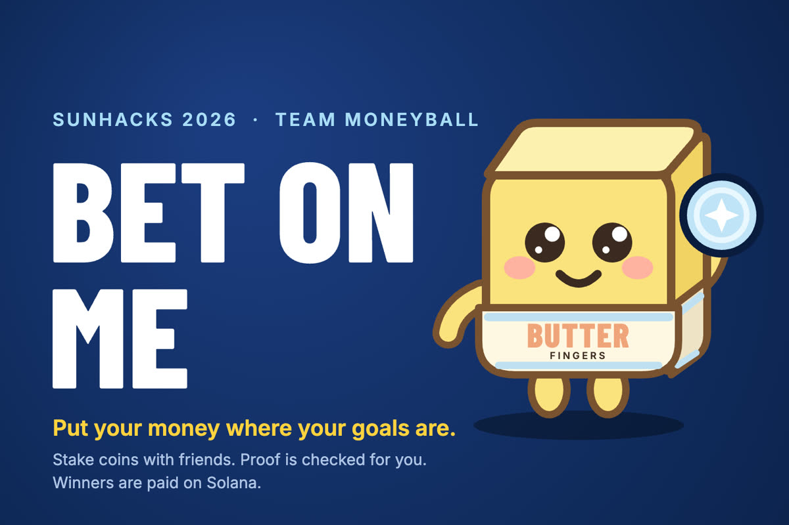
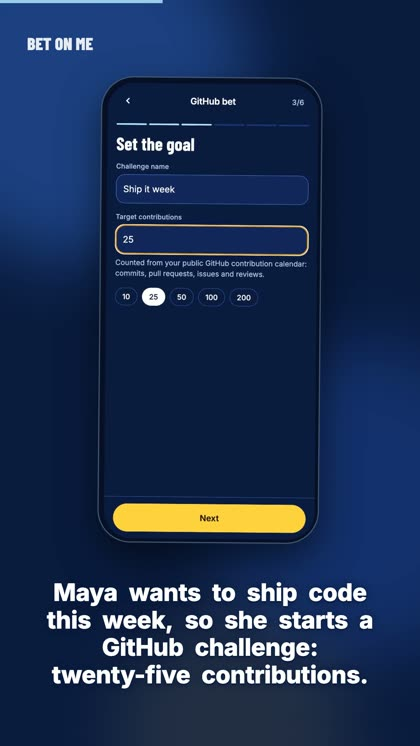
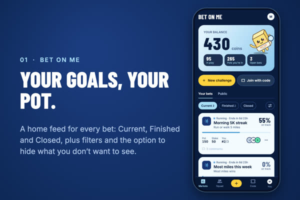
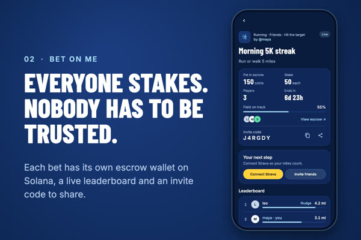
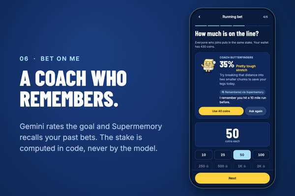
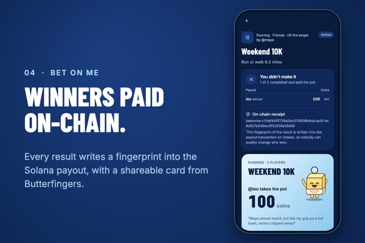

<div align="center">



# Bet On Me

**Put test coins on your own goals. Friends keep you honest, the app checks the proof, and winners get paid on Solana.**

[**Try it in your browser**](https://bet-on-me-web.vercel.app) · [**Watch the demo**](docs/demo.mp4)

Built at **sunhacks 2026** by team **Moneyball**. Everything runs on Solana **devnet** with test coins, so no real money is involved.

</div>

---

## Demo video

[](docs/demo.mp4)

A 90-second walkthrough narrated by Butterfingers: a GitHub bet from start to payout, plus how each technology is used. Click the image to play it.

## What it does

You create a challenge with a goal, a deadline and a stake. Friends (or the public) join and put the same amount into an escrow wallet. When time is up, the app checks each player's proof and pays the winners.

| Goal type | How the proof is checked |
|---|---|
| Running | Strava, GPS-recorded activities only (manual entries are ignored) |
| Chess | Live rating from the chess.com public API |
| GitHub | Public contribution calendar (commits, PRs, issues, reviews) |
| Duolingo | XP from the public profile |
| Dare | A 15-second video with a random liveness word, judged by Gemini, with disputes and votes |

For GitHub, Duolingo and chess, only progress made **after you join** counts. If a read from any source fails, create and join are refused instead of counting someone's whole history as progress.

<table>
  <tr>
    <td></td>
    <td></td>
  </tr>
  <tr>
    <td></td>
    <td></td>
  </tr>
</table>

## Features

**Money and payouts**
- Every user gets a custodial devnet wallet, funded from a treasury on sign-up.
- Every challenge has its own escrow wallet. Joining moves your stake in, and settlement pays winners out. Every transfer links to Solana Explorer.
- **Target** challenges: everyone hits it and stakes are returned; some hit it and they split the pot; nobody hits it and the leader takes it (dares refund).
- **Open** challenges: most progress takes the pot; ties split; no progress refunds everyone.
- **On-chain receipts:** each settlement writes a fingerprint of the result into the payout transaction with the Memo program (`betonme:v1:<challenge>:<outcome>:<hash>`), so the winner list can't be quietly changed.

**Coach Butterfingers (Gemini + Supermemory)**
- On the stake step, Gemini rates how doable the goal is (odds, verdict, tip). The stake suggestion is computed in code from those odds and your limits, **never by the model**.
- The coach remembers your past bets through [Supermemory](https://supermemory.ai) (one plain sentence per player, filed under the player id, no names) and says things like "I remember you missed your last running bet." If Supermemory is off or slow, it falls back to your history in MongoDB.
- After a bet settles, Gemini writes a one-line winner/loser comment for the share card.

**Around the bets**
- **Search:** typo-tolerant search of public bets and "Bets like this" suggestions with MongoDB Atlas Search (`moreLikeThis`).
- **Discussion threads** on every bet: comments, replies, mentions, nudges, backing and automatic updates. Links, phone numbers and emails are filtered, and comments are hidden after 3 reports.
- **Home feed** with Current / Finished / Closed tabs, a category filter, and a ⋯ menu to hide bets from your own list.
- **Clout points** (+10 join, +50 complete, +100 win, −20 fail) unlock higher stakes and more public dares.
- **Share cards** for settled bets (mascot, winner, pot, receipt), shared as an image on phones.
- **Dares** are screened by Gemini against community guidelines. Public challenges can be voted on and are removed and refunded after 3 reports.

## Tech stack

| Part | Tools |
|---|---|
| App | Expo (SDK 58, expo-router, Reanimated, react-native-svg) for iOS, Android and web |
| Backend | Node and TypeScript on Vercel serverless functions |
| Database | MongoDB Atlas, including Atlas Search |
| Blockchain | `@solana/web3.js` on devnet, with the Memo program |
| AI | Gemini (`@google/genai`) and Supermemory |
| Other | Vercel Blob for proof videos, EAS Update for app updates |

```
app/       Expo app (screens in app/src/app)
api/       Vercel entry point (one function serves every /api/* route)
server/    Routes, settlement, Solana, Gemini, Supermemory, Strava, chess.com, GitHub, Duolingo
lib/       Shared types and pure payout/points rules (unit tested)
scripts/   Key generation, local and staging servers, live checks, demo seeding
docs/      README images and the demo video
```

## Run it locally

**No keys needed** (in-memory database and a simulated chain):

```bash
npm install && npm run dev:local
```

```bash
cd app && npm install && npx expo start
```

To use a phone, set `EXPO_PUBLIC_API_URL` in `app/.env` to your computer's LAN address (for example `http://192.168.1.20:3000`) and scan the QR code with Expo Go.

<details>
<summary><b>Real setup (live services)</b></summary>

1. `npm run keys` generates the treasury wallet, wallet-encryption key and cron secret into `.env.local`, and prints the treasury address.
2. Fund the treasury address at <https://faucet.solana.com> (devnet). `npm run treasury` shows its balance.
3. Fill the rest of `.env.local` (see `.env.example`): `MONGODB_URI`, `GEMINI_API_KEY`, `BLOB_READ_WRITE_TOKEN`, `STRAVA_CLIENT_ID/SECRET/REDIRECT_URI`, and optionally `SUPERMEMORY_API_KEY`.
4. `npm run dev` runs a local backend against the real services. Or deploy to Vercel and add the same variables there.
5. Point the app at it with `EXPO_PUBLIC_API_URL=https://<your-vercel-domain>` in `app/.env`.

`DEMO_MODE=true` adds 5-minute challenges, a 10-second dispute window, an "End now" button and "Simulate progress".

</details>

## Tests

```bash
npm test
```

Runs the payout-rule unit tests and the end-to-end API tests (35 tests covering payouts, settlement, threads, GitHub/Duolingo, hiding and coach memory).

## Honest limits

This is a hackathon MVP.

- **Devnet only.** No real money. Wallets are custodial (keys encrypted with AES-256-GCM on the server).
- **Strava is a demo button.** Strava API access needs a Pro (paid) subscription, which we didn't have. The real OAuth path is built and switches on when Strava keys are set.
- **Usernames aren't verified.** GitHub and Duolingo usernames are not ownership-checked, and login is a username with no password, by design for the demo.
- **Settlement timing.** It runs when a challenge is opened after its end time, plus a daily cron (Vercel Hobby limit).
